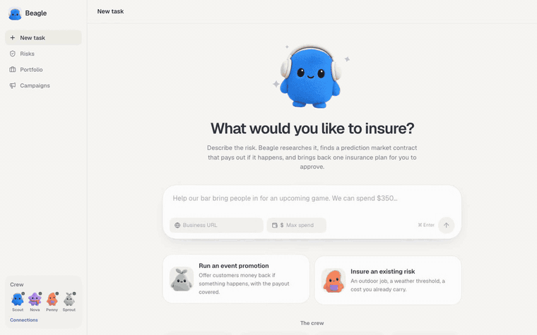
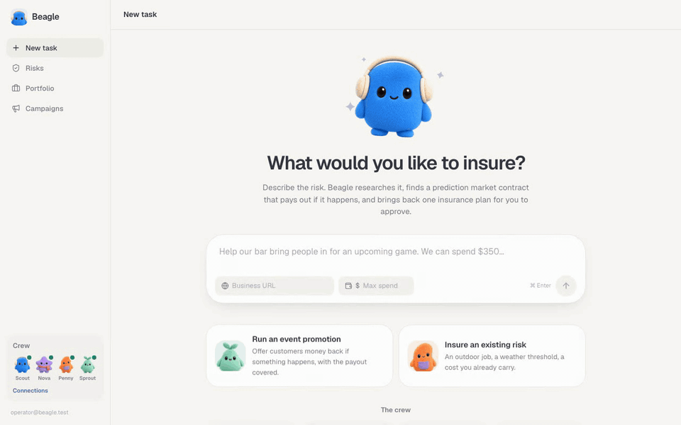
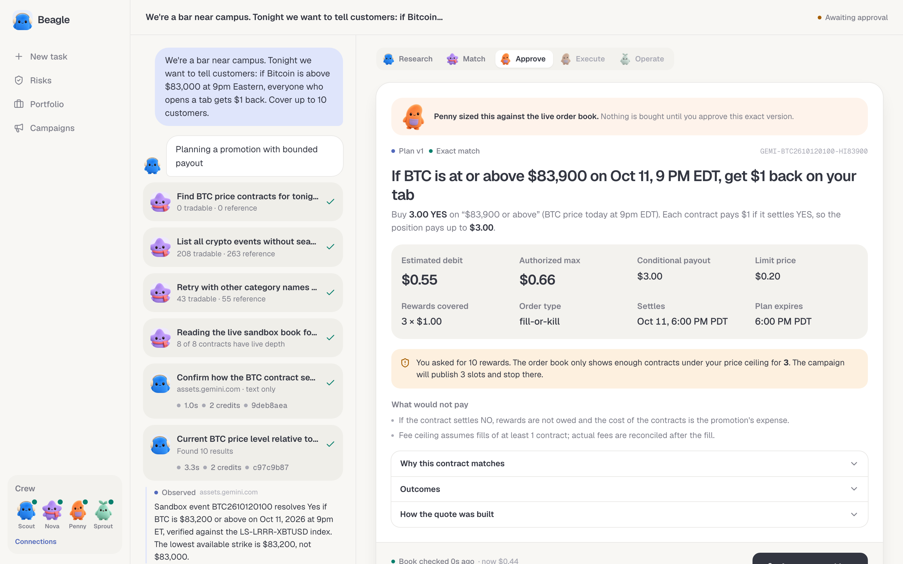
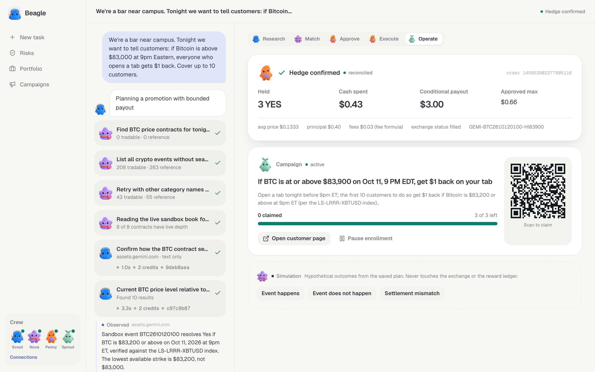
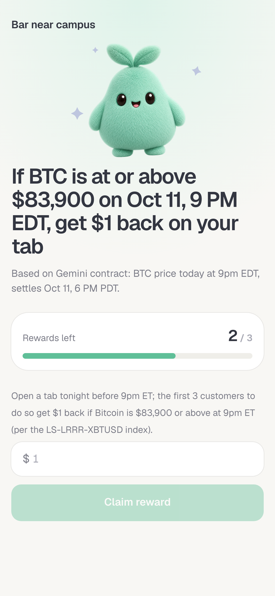
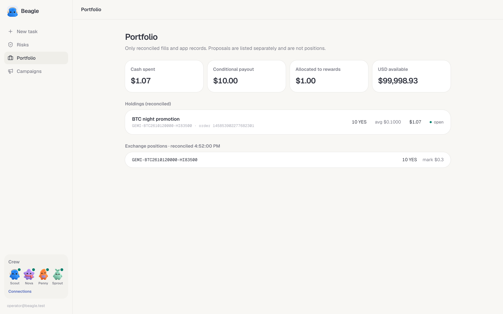

# Beagle


businesses are exposed to financial risks that traditional insurance often doesn't cover. prediction markets have started putting prices on those events, but business owners don't know how to use them. beagle is the agent that understands the business, finds a matching market, calculates what's actually protected, and executes a bounded hedge.

**try it: [beagle.andrewliu.org](https://beagle.andrewliu.org)**. no sign up. you get your own workspace, a real agent, and real Gemini sandbox orders (test money).



*a first-time visitor on the public site, recorded unedited and played back at about 5x. research, plan, approval and a real sandbox fill in about two and a half minutes.*

## why this is new

insurance is built for risks that repeat across thousands of customers. a bar betting its margin on one game night, or a painting crew that has to cancel a $3,000 job if tomorrow's high goes above 71°F, is too small, too specific and too short-lived to underwrite. those risks usually just go uncovered.

prediction markets already price a lot of these events, often by the hour. but a contract is not a policy. it pays on its own wording, at its own strike, from its own settlement source, and the price you see is only good for the size on the book. an owner reading "$83,500 or above, LS-LRRR-XBTUSD, 8pm ET" has no way to tell whether that covers their risk, or how much of it.

that translation is what beagle does:

- it reads your situation and the contract rules, and checks them field by field. when they don't line up it says so ("this settles at SFO airport, not your job site") instead of selling you a near-miss.
- it sizes the hedge against the real order book with the real fees, so the number on the plan is what the market can actually fill.
- it tells you what is protected and what is not before you spend anything. if the book only covers 3 of the 10 rewards you asked for, the plan says 3.
- the downside is fixed. you approve one exact plan with a hard maximum, it goes out as a single fill-or-kill order, and nothing else is ever bought.

## a real example

a bar near campus wanted to tell customers: "if Bitcoin is above $83,000 at 9pm, everyone who opens a tab gets $1 back, up to 10 people."

beagle searched the web through Context.dev for where BTC was trading, pulled every Gemini contract, and read the settlement terms. the 9pm event had no $83,000 strike (the lowest was $83,200), so it rewrote the customer promise to match the contract instead of hedging something that doesn't settle the same way. the $83,200 book was too thin, so it moved to the $83,900 strike and told the owner the hedge covers 3 rewards, not 10, for at most $0.66.

the owner approved. beagle bought 3 YES for $0.43 including fees (Gemini order `145853902277805116`), and the campaign opened with exactly 3 rewards. a customer claimed one from their phone.

the same flow works for sports and weather risks. Gemini's sandbox doesn't list those yet, so they run as research only for now, and the executable demo uses crypto.

## the crew

each card tells you who did the work.

<p>
  
  <strong>Scout</strong><br>
  researches your business through Context.dev and talks to you.
</p>

<p>
  
  <strong>Nova</strong><br>
  searches Gemini markets, checks live books and contract terms.
</p>

<p>
  
  <strong>Penny</strong><br>
  sizes the hedge, handles the budget, sends the approved order, and keeps the receipt.
</p>

<p>
  
  <strong>Sprout</strong><br>
  runs the test campaign and customer claims.
</p>

they bob while working, lean when waiting on you, and grey out when a provider is disconnected.

sandbox liquidity is thin, so campaigns stay small. all trades and rewards are for testing.

## demo

you describe the risk in plain words. Scout reads the web through Context.dev, Nova pulls every Gemini contract and the live order book, and Penny sizes a hedge against what is actually on offer.



Penny's plan is the only thing you approve. it shows the estimate and the hard maximum separately, what would not pay, and why the coverage is smaller than you asked for when the book is thin.



after the fill Sprout opens the campaign. it only publishes as many rewards as the confirmed contracts can pay, and customers claim from a QR code.



<p>
  
  
</p>

the portfolio only counts reconciled fills, never the submit response.



## what actually happened

this is not a mock. every number below came off the Gemini sandbox.

on 2026-10-11 23:40:52 UTC beagle bought 10 YES on `GEMI-BTC2610120000-HI83500` (BTC at or above $83,500 at 8pm EDT) at $0.10, fill-or-kill, Gemini order `145853902277682301`. it booked $1.00 principal plus $0.07 fee, which was the plan's estimate to the cent, then opened a 10 reward campaign that took its first claim. BTC closed above the strike and the contract paid $10.00 back into the sandbox account.

on 2026-10-12 at 00:40 UTC the bar run from the example above, started by a first-time visitor on the public site, got 3 YES on `GEMI-BTC2610120100-HI83900` at an average $0.1333, Gemini order `145853902277805116`: $0.40 principal plus $0.03 fee against a $0.55 estimate and a $0.66 approved max.

filming that run also caught a bug: the campaign headline moved to $83,900 but the agent's fine print still said $83,200 and "the first 10 customers". the planner now rewrites both to what was actually bought.

## how it works

- the agent works through typed tools: search and read the web, list Gemini contracts, inspect a contract with its live depth, record evidence, and propose a plan. it cannot buy anything. a finding only counts as evidence if the quoted passage exists in the captured page.
- quotes come from observed book levels with Gemini's published taker fee, `0.07 * C * P * (1 - P)` rounded up per fill. nothing extrapolates past the book.
- a plan is an immutable version bound by a sha256 hash. approving it reserves the max debit, and the order goes out as one fill-or-kill limit order.
- holdings come from Gemini order history and positions after the fact. if a submit times out the run sits in `EXECUTION_UNKNOWN` with funds reserved until reconcile finds the order.
- the money rules live in Postgres, not just in code: no oversubscribed holdings, plans can't be edited after the fact, one order per approval, and claims go through a function that locks the row, so 12 concurrent claims for 3 slots give exactly 3.
- jobs run off a Postgres queue with `SKIP LOCKED` leases. on Vercel there is no long running worker, so each request drains due jobs after it responds and the event stream reads the log, which means any instance can serve any run.

more detail in [docs/architecture.md](docs/architecture.md) and [ADR 0001](docs/decisions/0001-sandbox-inventory-drives-the-demo.md).

## run it locally

needs Node 22+, pnpm, Docker, and the Supabase CLI.

```bash
pnpm install
pnpm db:start                       # local supabase on 553xx ports
cp .env.example .env                # fill in the Context.dev, Gemini sandbox and model keys
pnpm --filter @beagle/service seed  # demo operator + Golden Bear Taproom
pnpm dev:service                    # :4000
pnpm dev:web                        # :3100
```

`pnpm preflight` checks every provider and quotes the live sandbox book without placing anything. Gemini master keys need `GEMINI_ACCOUNT` and `GEMINI_NONCE_MODE=time-based`.

```bash
pnpm test        # 83 unit tests: fees, book walking, quoting, matching, fill ledger, master key signing, campaign copy
pnpm test:db     # 10 database invariant tests against local supabase
```

## known limits

- Gemini's sandbox only lists crypto and commodities, and its depth sits almost entirely in contracts settling within the hour. sports and weather matches are research only until those show up in sandbox, and campaigns stay small.
- that hourly book moves every few seconds. a plan can go unfillable before you click approve, and the button stays disabled until it fits again. there is no one click re-quote yet.
- Gemini's websocket rejects master API keys, so with one the fees are booked from the published formula instead of the per-fill stream. the receipt says which.
- the public demo caps each visitor at 6 new runs an hour since every run spends real model and Context.dev credits.

## built with

Context.dev, Gemini Predictions API, Anthropic, Next.js, Fastify, and Supabase.

crew art from [OpenDots](https://github.com/CopilotKit/OpenDots), workspace inspiration from [OpenMuse](https://github.com/CopilotKit/OpenMuse). both MIT licensed.

built for Blockchain at Berkeley Hacks 2.0, the Gemini Predictions API track, and the Context.dev bonus.
