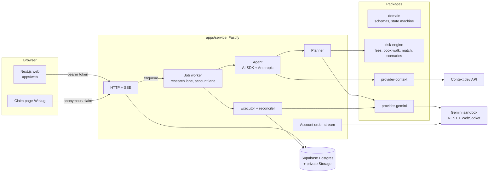

# Architecture

Beagle is two processes and a database.



## Who decides what

| Decision | Made by | Why |
|---|---|---|
| What the business sells, which event matters to its customers | Agent, from Context.dev captures | Needs reading and judgment |
| Whether a fact is "observed" | `ResearchToolkit.recordEvidence` | The quoted passage must exist in a stored capture, or it is an inference |
| Whether a contract pays on the trigger | `risk-engine/match.ts` | Field-by-field, deterministic, tested on real listings |
| Quantity, limit price, fees, max debit | `risk-engine/quote.ts`, `fees.ts` | Decimal math against the observed book, never the model |
| Whether to buy | The merchant, one click on one plan version | Approval binds to a sha256 of the canonical plan |
| Whether conditions still hold at submit | `execution/quote-check.ts` | Re-reads rules hash, market state and depth; no model in the loop |
| How much was bought | Gemini order history + positions | The submit response is never the source of truth |
| How many customers can claim | `claim_entitlement()` in Postgres | Row locks and a CHECK constraint, not application code |

The model has six tools: `read_source`, `search_evidence`, `list_market_candidates`, `inspect_contract`, `record_finding`, `propose_plan`. None of them can place an order. Scraped text reaches the model wrapped in `<untrusted_source>` tags and can not change tools, budgets or approvals.

## Run lifecycle

```
DRAFT -> RESEARCHING -> MATCHING -> QUOTING -> AWAITING_APPROVAL -> APPROVED -> SUBMITTING -> RECONCILING -> ACTIVE
              |                         |              |                              |              |
         NEEDS_INPUT          NO_EXECUTABLE_MATCH   (new plan version)        EXECUTION_UNKNOWN    NO_FILL
```

`packages/domain/src/state-machine.ts` holds the transition table. Every state change goes through `runs.transition()`, which writes the new state and its event in one transaction.

## Execution path, step by step

1. `POST /api/plans/:id/approve` with the version and hash the merchant saw, plus an idempotency key.
2. In one transaction: lock the plan, recompute its hash, check the last book check is under `QUOTE_MAX_AGE_MS` (5s), check the account lane is free, insert the approval, reserve the max debit, insert one `exchange_orders` row (unique per approval), move the run to `APPROVED`.
3. The `account:sandbox-primary` lane picks up `execute_order`. Only an order in state `pending` is ever sent.
4. Revalidate: terms accepted, rules hash unchanged, market open, the book still fills the full quantity at or under the limit, estimate under the max debit. Any failure releases the reservation and issues a new plan version.
5. Take the account lane, send one `fill-or-kill` limit order with the documented `OrderRequest` fields.
6. Accepted: reconcile from `orders/history` and `positions`. Rejected (4xx): release funds. Timeout or 5xx: `EXECUTION_UNKNOWN`, keep funds reserved, keep the lane blocked, reconcile by matching symbol, side, outcome, quantity, price and time window. Two matches stay unknown for an operator.
7. Confirmed quantity creates a holding. Campaign capacity is `floor(filled / reward)`.

On boot the service enqueues reconciliation for every order left in `submitting`, `accepted` or `unknown` before it takes new work.

## Invariants and where they are enforced

| PRD invariant | Enforcement | Test |
|---|---|---|
| 1. No financial mutation without approval | `exchange_orders.approval_id` not null + unique | `invariants.test.ts` |
| 2. Spend + reservations within approved budget | `budget_reservations` CHECK and trigger | `invariants.test.ts` |
| 3. Committed units + holds within holdings | `holdings_no_oversubscription` CHECK | 12 concurrent claims on 3 slots |
| 4. One payout unit, one obligation | `position_allocations.entitlement_id` unique | `invariants.test.ts` |
| 5. Unknown state blocks new commitments | `exchange_accounts.blocked_by_order_id` checked under row lock at approval | `approve.ts` |
| 6. Pausing never retracts | `pause_campaign()` only updates campaign status | `invariants.test.ts` |
| 7. Unverified facts cannot become asserted | `evidence` CHECK + passage-in-capture check | `invariants.test.ts`, `toolkit.ts` |
| 8. Replays cannot touch the real ledger | `simulations` table has no FK to orders, holdings or entitlements | schema |

## Fees

Gemini's published taker fee is `0.07 × C × P × (1 − P)`, rounded up to the cent, per fill. The four worked examples on gemini.com/fees/predictions are unit tests. Because each fill rounds separately, the reservation uses a provable ceiling:

```
sum_i ceil(c q_i v_i) <= c Q vmax + N * 0.01      where N = ceil(Q / fillUnit), vmax = max p(1-p) on [priceMin, limit]
```

and takes the tighter of that and `N * ceil(c * fillUnit * vmax)`. With the PRD's own numbers (800 contracts, limit 0.41, one-contract fills) this gives the PRD's $16.00.

## Book math

Gemini publishes one book per contract in YES price space. Buying YES walks YES asks. Buying NO walks YES bids transformed to `1 - p`, best bid first. `book.test.ts` uses a book captured from the sandbox and asserts that the NO price is never `1 - bestAsk`.

## Fill counting

From Gemini's order stream docs: on `FILLED`/`PARTIALLY_FILLED`, `Z` is that execution's quantity; on `CANCELED`, `Z` is cumulative. A fully filled IOC ends `CANCELED`. `FillLedger` sums unique trade ids and uses the terminal cumulative only as a cross-check, never added on top.
